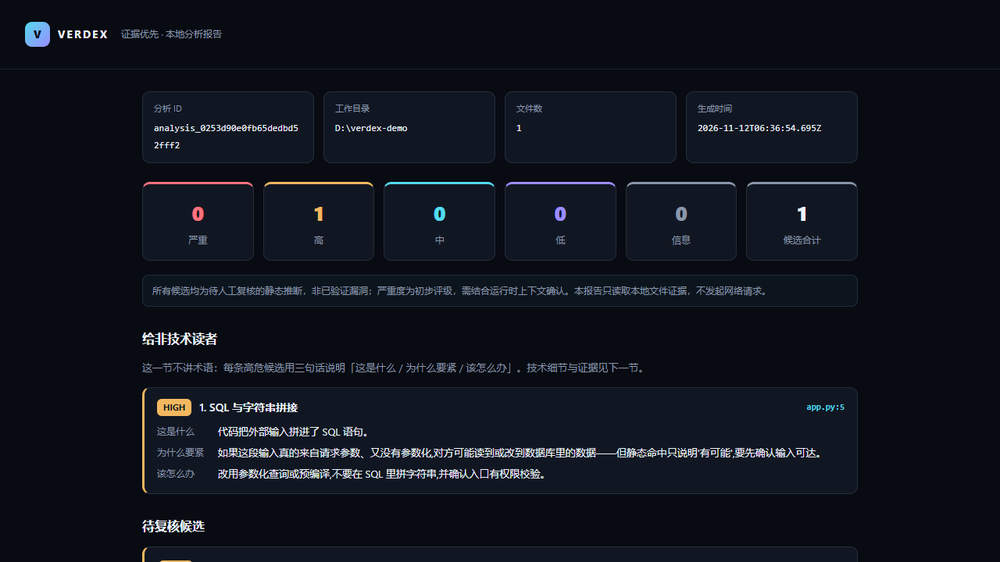

# Verdex

[](https://hub.xerj.org/contributors/Yilanchia)
[](https://m8ven.ai/mcp/yilanchia-verdex-1s28o0?s=readme)
[](https://github.com/Yilanchia/Verdex/actions/workflows/ci.yml)

**Evidence-first local security research toolset, driven by LLMs over MCP.**
**证据优先的本地安全研究工具集**:把源码审计、二进制逆向、pwn/web 攻防辅助、移动端与固件分析,变成大模型可自主编排的**只读工具链**——不是一张静态工具台,而是一条"资产证据 → 静态关系 → 数据流候选 → 人工结论"的可复核链路。

> **负责任使用 / Responsible use**
> Verdex 全程**只读分析、只生成文本**:不执行目标、不发起网络请求、不自主攻击、不生成专打未授权目标的载荷。`pwn_*` / `web_poc` / `web_recon` / `frida_script` / `impact_proof` 必须显式声明**授权目标**(CTF、自建实验室、你拥有或被明确授权的系统),且只产出由你审阅、由你在授权范围内亲自运行的文本。禁止用于未授权目标。

---

## 这是什么

- **一个 MCP server**:`verdex-mcp` 通过 stdio + JSON-RPC 2.0 暴露 35 个只读工具,DeepSeek Harness / Claude Code / Claude Desktop / Cursor / Cline / Codex 等任何 MCP 宿主都能直接驱动。
- **一套分析内核**:AST 代码图、规则命中、source→sink 数据流、证据指纹去重、brief 范围与红线、不可变 run 快照(JSON + Markdown + 自包含 HTML + SARIF)。
- **一个本地工作台**:`npm start` 打开 `http://127.0.0.1:3210`,选目录、补资产、看候选、保存快照。只监听本机,分析接口不联网。

## 给谁用

| 你是谁 | Verdex 帮你做什么 | 从哪开始 |
| --- | --- | --- |
| 安全研究员 / 源码审计 | 把证据链、数据流候选、去重指纹整理成可复核的快照,省掉手工汇总 | `scan` → `report` |
| SRC / 漏洞赏金猎人 | 给一个域名生成分阶段侦察剧本;把"条件性理论风险"升级成可复核的已证影响方案 | `analyze_target` → `web_recon` / `impact_proof` |
| 逆向 / pwn / CTF 选手 | checksec、gadget、libc 偏移、偏移求解、gdb 脚本、exploit 脚手架、反编译 | `VERDEX_PROFILE=pwn` + `pwn_*` / `bin_decompile` |
| 想搞懂自己 App 的开发者 | 解 APK/IPA/小程序/Electron/固件,看权限、导出组件、硬编码密钥、明文传输 | `mobile_unpack` → `secrets` / `har_analyze` |

## 5 分钟上手

### 0) 环境

- Node.js **>= 20**(CI 覆盖 20 / 22 / 24)
- 可选后端:`binutils`(逆向基础)、Ghidra 或 IDA(反编译)、jadx(Android)、ilspycmd(.NET)、WSL + squashfs-tools(固件)。装没装、装在哪,一条命令说清楚:

```bash
node src/cli.js doctor
```

### 1) 起 MCP server(从 GitHub 源码运行)

```bash
git clone https://github.com/Yilanchia/Verdex.git
cd Verdex
npm ci

# 起 stdio MCP server,阻塞等待宿主连接
node src/cli.js mcp
```

> npm 包暂未发布(npm 现在要求发布者先启用 2FA)。发布后会补上 `npx -y verdex-mcp` 的一行安装;在那之前,GitHub 源码就是官方安装方式,功能完全一致。

进程启动后阻塞等待 stdio,把下面任意一段配置贴进宿主即可。

### 2) 接进你的 agent

**Claude Desktop / Cursor / Cline**(`claude_desktop_config.json` / `~/.cursor/mcp.json`):

```json
{
  "mcpServers": {
    "verdex": {
      "command": "node",
      "args": ["/absolute/path/to/Verdex/src/cli.js", "mcp"]
    }
  }
}
```

> npm 包发布后可以换成 `{ "command": "npx", "args": ["-y", "verdex-mcp"] }`,少一个克隆步骤。

**DeepSeek Harness**(profile 的 `cordis.yml` / `verdex-mcp.patch.yml`):

```yaml
- id: mcp-verdex
  name: '@deepseek-ai/dsh-mcp-client'
  config:
    serverName: verdex
    transport: stdio
    command: node
    args: ['/absolute/path/to/Verdex/src/cli.js', 'mcp']
```

挂载后模型会看到 `mcp__verdex__scan`、`mcp__verdex__bin_decompile` 等工具。`verdex-mcp.patch.yml` 是现成的 dsh 补丁文件,`dsh web --patch verdex-mcp.patch.yml` 可一次性试用。

### 3) 跑通第一次

在对话里依次让 agent 调:

1. `analyze_target` —— 丢一个**本地路径**或**你被授权的域名**,它识别类型并返回推荐工具链。
2. `scan` —— 对目录跑完整静态分析(资产、代码图、规则、数据流候选)。
3. `report` —— 存一份不可变快照,打开返回的 `report.html` 就能看到严重度看板与证据链。
4. 想让人看懂?`explain` 把任意一条发现翻译成"这是什么 / 为什么要紧 / 该怎么办"。



> 报告顶部会先给非技术读者一个三句话摘要(上图),证据链、CWE、置信度和修复方向在后面的候选卡片里。

```text
$ node src/cli.js scan ./samples/demo
{ "schema": "VerdexProject/v1", "assets": { ... }, "scan": { "findings": [ ... ] } }

$ node src/cli.js report ./samples/demo
{ "saved": { "markdown": ".verdex/runs/<id>/report.md", "html": ".../report.html", "sarif": ".../report.sarif" } }
```

### 4) 命令行也顺手

```bash
node src/cli.js scan   <dir> [brief.json]     # 完整静态分析
node src/cli.js assets <dir>                  # 域名/URL/IP + 文件行号
node src/cli.js map    <dir>                  # 代码图(文件/函数/路由/调用)
node src/cli.js osint  <dir> [brief.json]     # 本地 OSINT,默认脱敏
node src/cli.js report <dir> [out] [brief]    # 不可变快照:JSON/MD/HTML/SARIF
node src/cli.js doctor                        # 自检后端
node src/cli.js --version | help
```

## 安全模型:三道闸 + 只读原则

Verdex 的立身之本是**只读、只产文本、不自主攻击**。这条线写在代码里,不是写在 README 里:

| 闸 | 含义 | 落在哪里 |
| --- | --- | --- |
| ① 授权声明必填 | `web_recon` 要 `domain`,`web_poc` 要 `url`,`pwn_template` 要 `target`,`frida_script` 要 `target`;缺失直接拒绝 | 工具入参校验 + 授权 banner |
| ② 只产文本 | 从不发请求、不 attach/注入、不执行目标、不代跑命令 | 模块里没有网络/注入能力;测试断言 `openWorldHint:false` |
| ③ 人在环路 | 生成的命令/脚本由你审阅后在授权范围亲自运行 | 输出里写明"你在授权范围自行执行"与停止点 |

此外:
- `brief` 强制范围、漏洞类型、最低置信度与 `no-payload / no-bruteforce / no-out-of-scope` 红线;试图降低红线会被拒绝。
- 所有发现都是**待人工复核的静态推断**,不是"已验证漏洞";报告里明确标注 epistemic state 与 limitations。
- `report` 的 HTML 自包含、可离线打开;`.verdex/runs` 是不可变快照,便于复盘与对比(`diff`)。

## 工具一览(35)

完整清单、输入参数、后端依赖见 **[docs/tools.md](docs/tools.md)**。

| 分类 | 工具 | 你需要什么 |
| --- | --- | --- |
| 源码 / 项目 | `assets` `map` `scan` `osint` `report` `diff` `secrets` | 无(纯 Node) |
| 编排 / 解释 | `analyze_target` `explain` | 无 |
| 二进制逆向 | `bin_info` `bin_symbols` `bin_strings` `bin_disasm` `bin_dossier` `bin_decompile` `reconstruct` | binutils;反编译需 IDA 或 Ghidra |
| pwn 辅助(仅授权靶场) | `pwn_checksec` `pwn_gadgets` `pwn_template` `pwn_cyclic` `pwn_gdbscript` `pwn_libc` | binutils;生成文本,不连接/不执行 |
| Web 攻防辅助 | `web_recon` `har_analyze` `web_poc` | 你抓的 HAR;生成剧本/请求模板 |
| 移动端 | `mobile_unpack` `wxapkg_unpack` `dex_decompile` | 纯 Node;jadx 用于 DEX→Java |
| 固件 | `fw_scan` `fw_extract` | WSL + squashfs-tools(Windows) |
| JS / Electron / .NET | `js_deobfuscate` `asar_unpack` `dotnet_decompile` | 纯 Node;ilspycmd 用于 .NET |
| 动态辅助 / 影响验证 | `frida_script` `impact_proof` | 只需授权声明;只产文本 |

小提示:在 pwn/CTF 环境里设 `VERDEX_PROFILE=pwn`,只向模型暴露精简工具面(省上下文),能力不删——隐藏的工具仍可被调用。

## 本地 GUI

```bash
npm start          # http://127.0.0.1:3210
```

选工作目录 → 补域名/URL/IP → 填 brief → 看覆盖、资产面、脱敏 OSINT、待复核候选 → 保存快照。服务只监听本机;分析不联网;"AI 设置"默认关闭,只有你明确开启并点"复核当前候选"才会发送有限候选证据(API Key 只在进程内存)。

## 证据模型

工程采用四层证据模型:**资产证据 → 静态关系 → 数据流候选 → 人工结论**。每层保留 `authority`、`epistemic state`、`confidence`、`coverage` 与 `limitations`。静态关系和数据流都是 `inferred`,不能单独证明运行时可达、权限缺失或漏洞可利用;后续接入 AST / Semgrep / 运行时证据时,不会把推断伪装成事实。

- 去重:发现按**证据指纹**去重,保留来源与证据链(`file:line` + 片段 + 文件哈希)。
- 快照:每次 `report` 生成新的不可变 run 目录,`diff` 按指纹分出新增 / 已修复 / 仍存在。
- 输出:`scan` 输出 `VerdexScan/v2`;快照含 `analysis.json`、`findings.json`、脱敏 `osint.json`、`report.md`、`report.html`、`report.sarif`(SARIF 2.1.0,可上传 GitHub 代码扫描)。

## 可选后端

| 后端 | 用途 | 配置 |
| --- | --- | --- |
| binutils(`objdump`/`nm`/`strings`/`file`) | 逆向基础 | 放进 PATH(Windows 用 MSYS2/ucrt64) |
| IDA Pro / Hex-Rays | `bin_decompile` 首选后端 | `VERDEX_IDA` → `idat.exe` / `idat64` |
| Ghidra headless | `bin_decompile` 免费回退 | `VERDEX_GHIDRA` → `support/analyzeHeadless[.bat]`,需 JDK 21+ |
| jadx | APK/DEX → Java | `VERDEX_JADX` → `bin/jadx[.bat]` |
| ilspycmd + .NET runtime | .NET → C# | `VERDEX_ILSPY` → `ilspycmd.dll`;`VERDEX_DOTNET` 可选 |
| WSL + squashfs-tools | 固件解包(Windows) | `VERDEX_WSL_DISTRO` 指定发行版 |

`verdex doctor` 会逐项报告"找到没有、在哪、缺了影响哪些工具",不会运行目标、不会联网。

## 不做什么(边界)

- 不执行目标文件,不 attach 进程,不注入代码,不发 HTTP/DNS 请求。
- 不生成专打未授权目标的载荷,不提供自动化攻击链执行。
- 不做身份反查、账号关联、数据经纪查询;本地 OSINT 默认脱敏。
- 不把推断说成事实:静态候选一律标 `inferred`,需回原文件核对。
- 不受理"绕过授权闸 / 攻击未授权系统"的功能请求与 issue。

## 开发与贡献

```bash
npm ci
npm test            # node --test:MCP 协议、CLI、分析内核与各工具用例
npm run doctor      # 环境自检
```

- 新工具约定、红线、提交规范见 **[CONTRIBUTING.md](CONTRIBUTING.md)**。
- 变更记录见 **[CHANGELOG.md](CHANGELOG.md)**。
- 安全问题请按 **[SECURITY.md](SECURITY.md)** 私下报告,不要开公开 issue。

## 许可

MIT © 2026 Yilanchia
